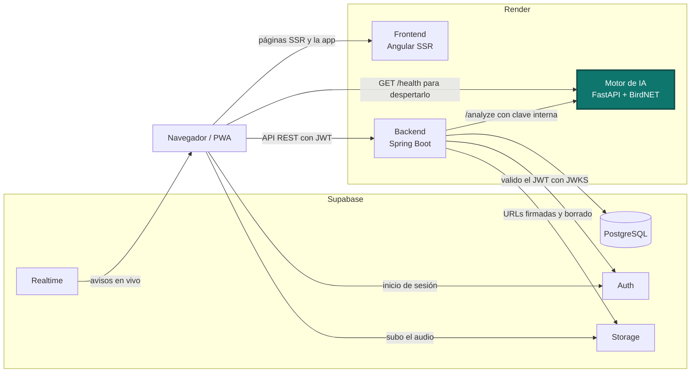
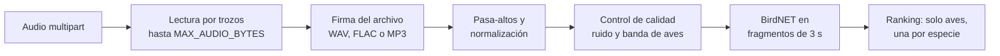

<h1 align="center">AlaSonora · Motor de IA</h1>

<p align="center">
  El motor que identifica la especie en AlaSonora, la app que reconoce aves por su canto y las reúne en
  un mapa compartido. Pruébala en <a href="https://alasonora.com">alasonora.com</a>.
</p>

<p align="center">
  <a href="https://github.com/solartedaniers/AlaSonora-IA/actions/workflows/ci.yml"></a>
  <a href="https://www.python.org/downloads/release/python-3123/"></a>
  <a href="https://fastapi.tiangolo.com"></a>
  <a href="https://github.com/birdnet-team/BirdNET-Analyzer"></a>
  <a href="https://pypi.org/project/birdnetlib/"></a>
  <a href="https://docs.docker.com"></a>
</p>

## Contenido

- [El proyecto](#el-proyecto)
- [Arquitectura](#arquitectura)
- [Identificación por foto: mejora futura](#identificación-por-foto-mejora-futura)
- [Tecnologías](#tecnologías)
- [Requisitos previos](#requisitos-previos)
- [Variables de entorno](#variables-de-entorno)
- [Correrlo en local](#correrlo-en-local)
- [Pruebas](#pruebas)
- [Cómo uso BirdNET](#cómo-uso-birdnet)
- [API](#api)
- [Errores](#errores)
- [Despliegue en Render](#despliegue-en-render)
- [Estructura](#estructura)
- [Problemas comunes](#problemas-comunes)

## El proyecto

AlaSonora tiene tres repositorios:

| Parte | Repositorio | Papel |
|---|---|---|
| Frontend | [AlaSonora-Frontend](https://github.com/solartedaniers/AlaSonora-Frontend) | PWA en Angular con SSR: grabación, espectrograma, mapa y modo offline |
| Backend | [AlaSonora-Backend](https://github.com/solartedaniers/AlaSonora-Backend) | API REST en Spring Boot: sesiones, base de datos, Storage y orquestación de la IA |
| Motor de IA | **este repositorio** | Microservicio en FastAPI que identifica la especie con BirdNET |

En este repositorio está el motor de IA. Lo construí como un servicio aparte para que el modelo, que
pesa varios cientos de MB y carga lento, no viviera dentro del backend. Recibe un audio, revisa que
sea de verdad WAV, FLAC o MP3 y que no pase el tope, lo limpia, comprueba que suene a ave y se lo pasa
a BirdNET. Las rutas de análisis solo las llama el backend, con una clave interna. El navegador solo
toca `/health`, para despertar el servicio en Render.

## Arquitectura

El recuadro resaltado es este repositorio.



## Identificación por foto: mejora futura

La función principal de AlaSonora es identificar aves por su canto con BirdNET, y está activa. La
identificación por foto la dejé como mejora futura y la apagué a propósito: es una decisión, no un
error. El motor ya tiene el endpoint `/classify-photo`, pero en producción está desactivado con
`PHOTO_CLASSIFICATION_ENABLED=false` en el motor y `photoIdentificationEnabled=false` en el frontend.
Lo hice porque el servidor gratis de Render tiene 512 MB de RAM: el audio usa unos 360 MB y con fotos
el proceso llegaría a unos 750 MB.

## Tecnologías

| Pieza | Versión |
|---|---|
| Python | 3.12.3 (fijada en `.python-version` y en el `Dockerfile`) |
| FastAPI | 0.162.0 |
| Uvicorn | 0.54.0 |
| birdnetlib (BirdNET-Analyzer, modelo `BirdNET_GLOBAL_6K_V2.4`) | 0.18.1 |
| ai-edge-litert (intérprete TFLite) | 2.3.0 |
| librosa | 1.0.0 |
| NumPy / SciPy | 2.5.4 / 1.18.1 |
| pydantic-settings | 2.16.1 |
| httpx2 (solo pruebas) | 2.16.0 |

`requirements.txt` no fija versiones. Las de la tabla son las que tengo instaladas y con las que pasan
las pruebas; Render instala las últimas al construir la imagen.

## Requisitos previos

- **Python 3.12.3**. Lo verificas con `python --version` (en Windows también sirve `py -3.12 --version`).
- **pip**, que viene con Python.
- **Docker**, solo si quieres correr la misma imagen que corre en Render (`docker --version`).
- No necesitas ffmpeg: la imagen de producción tampoco lo trae y `soundfile` lee WAV, FLAC y MP3.

## Variables de entorno

Salen de `app/config.py` y se pueden poner en un `.env` (el ejemplo está en `.env.example`). Solo
`INTERNAL_API_KEY` es obligatoria; el resto tiene el valor por defecto de la tabla.

| Variable | Para qué sirve | Obligatoria | Por defecto |
|---|---|---|---|
| `INTERNAL_API_KEY` | Clave que el backend envía en `X-Internal-Api-Key`. Debe ser igual a `AI_ENGINE_API_KEY` del backend | Sí | — |
| `DEFAULT_MIN_CONFIDENCE` | Confianza mínima de BirdNET si el backend no la envía | No | `0.1` |
| `DEFAULT_MAX_RESULTS` | Especies máximas por análisis | No | `3` |
| `MAX_INFERENCE_WORKERS` | Hilos del pool donde corre la inferencia | No | `2` |
| `MAX_AUDIO_BYTES` | Tamaño máximo del audio. Lo leo por trozos y corto apenas lo pasa (413). Igual a `audio.upload.max-bytes` del backend | No | `10485760` (10 MB) |
| `MAX_PHOTO_BYTES` | Tamaño máximo de la foto, con la misma lectura por trozos | No | `10485760` (10 MB) |
| `AUDIO_HIGHPASS_CUTOFF_HZ` | Corte del filtro pasa-altos | No | `300.0` |
| `AUDIO_NOISE_FLATNESS_THRESHOLD` | Aplanamiento espectral a partir del cual considero el audio ruido | No | `0.3` |
| `AUDIO_BIRD_BAND_ENERGY_RATIO_THRESHOLD` | Energía mínima en la banda de aves (0,4–8 kHz) | No | `0.15` |
| `PHOTO_CLASSIFICATION_ENABLED` | Activa `/classify-photo`. En `false` responde 503 sin cargar el modelo. En el código vale `true`; en producción y en `.env.example` va en `false`, porque la instalación base no trae torch ni transformers | No | `true` |
| `PHOTO_MODEL_ID` | Modelo de Hugging Face para fotos | No | `dennisjooo/Birds-Classifier-EfficientNetB2` |
| `DEFAULT_PHOTO_MIN_CONFIDENCE` | Confianza mínima por foto | No | `0.3` |
| `DEFAULT_PHOTO_MAX_RESULTS` | Resultados máximos por foto | No | `3` |
| `PORT` | Puerto del contenedor. No está en `config.py`: solo lo lee el `CMD` del `Dockerfile`, y Render lo inyecta | No | `8000` |

## Correrlo en local

```bash
git clone https://github.com/solartedaniers/AlaSonora-IA.git
cd AlaSonora-IA
python -m venv .venv
source .venv/Scripts/activate   # Windows con Git Bash (en PowerShell: .venv\Scripts\Activate.ps1)
source .venv/bin/activate       # Linux / macOS
pip install -r requirements.txt
cp .env.example .env            # cambia INTERNAL_API_KEY por tu clave
uvicorn app.main:app --host 0.0.0.0 --port 8000
```

El primer arranque tarda un poco porque carga BirdNET. Cuando termina, el motor queda en
`http://localhost:8000`. Lo compruebas así:

```bash
curl http://localhost:8000/health
# {"status":"ok"}

curl -X POST http://localhost:8000/analyze \
  -H "X-Internal-Api-Key: <tu INTERNAL_API_KEY>" \
  -F "audio=@grabacion.wav" -F "min_confidence=0.1" -F "max_results=3"
# {"candidates":[{"scientific_name":"...","common_name":"...","confidence":0.87}]}
```

Si también quieres la identificación por foto: `pip install -r requirements.txt -r requirements-photo.txt`
y deja `PHOTO_CLASSIFICATION_ENABLED=true`. Son torch, torchvision, transformers y pillow, en sus
versiones solo para CPU.

### Conectarlo con los otros dos servicios

1. En el `.env` del backend pongo `AI_ENGINE_BASE_URL=http://localhost:8000` y `AI_ENGINE_API_KEY`
   con el mismo valor que `INTERNAL_API_KEY` de aquí.
2. Arranco el backend (`./mvnw spring-boot:run`, queda en `http://localhost:8083`).
3. Arranco el frontend (`npm start`, queda en `http://localhost:4200`). En desarrollo ya apunta al
   backend en `localhost:8083` y al `/health` de este motor en `localhost:8000`.

## Pruebas

Son autoverificaciones con `assert` en `app/test_*.py`, sin pytest. Ninguna carga BirdNET: usan señales
sintéticas o un clasificador falso, así que corren en segundos.

```bash
pip install -r requirements-dev.txt   # suma httpx2, que necesita el TestClient
cp .env.example .env                  # basta con el valor de ejemplo
python -m app.run_tests               # corre las 9 y falla si alguna falla
python -m app.test_upload_limits      # o una sola
```

Cubren el análisis, la limpieza y el control de calidad del audio, la clave interna, el ranking de
candidatos, la configuración, `/health`, la foto apagada y los límites de tamaño y formato. El workflow
`.github/workflows/ci.yml` hace lo mismo en cada push a `main` y en cada pull request, con la versión de
Python de `.python-version`.

Para construir la imagen de producción en local:

```bash
docker build -t alasonora-ia .
docker run --rm -p 8000:8000 -e INTERNAL_API_KEY=<clave> -e PHOTO_CLASSIFICATION_ENABLED=false alasonora-ia
```

## Cómo uso BirdNET

`app/classifier.py` envuelve el `Analyzer` de birdnetlib. Lo cargo una sola vez al arrancar (en el
`lifespan` de FastAPI) y lo reutilizo en cada petición. Para cada audio:



1. **Límite** (`app/bounded_upload.py`): leo el archivo por trozos y corto con 413 apenas pasa
   `MAX_AUDIO_BYTES`, sin leer más allá del tope.
2. **Formato** (`app/file_signature.py`): reconozco el formato real por sus primeros bytes, no por el
   nombre ni por el tipo declarado. Acepto `RIFF…WAVE`, `fLaC` y MP3 (etiqueta `ID3` o un frame MPEG).
   Para fotos, JPEG, PNG y `RIFF…WEBP`. Si no coincide, respondo 415.
3. **Limpieza** (`AudioPreprocessor`): filtro pasa-altos y normalización de pico.
4. **Control de calidad** (`AudioQualityAnalyzer`): si hay demasiado ruido o no hay energía en las
   frecuencias de aves, respondo 422 con un código claro en vez de dejar que BirdNET adivine.
5. **Análisis**: BirdNET puntúa el audio en fragmentos de 3 s. Le paso la fecha de grabación y, solo
   si el dispositivo tenía GPS real, la latitud y longitud, para que filtre las especies esperables en
   esa zona.
6. **Ranking** (`rank_candidates`): descarto las etiquetas que no son aves (voz humana, motor, sirena,
   ruido…), dejo una entrada por especie con su mejor confianza y devuelvo las mejores.

birdnetlib busca `tflite_runtime`, que no tiene wheels para Python 3.12 ni para Windows. Por eso
registro `ai-edge-litert` con ese nombre antes de importarlo, y así evito cargar TensorFlow completo,
que son unos 180 MB más de RAM.

La inferencia es bloqueante, así que corre en un `ThreadPoolExecutor` de `MAX_INFERENCE_WORKERS` hilos
para no congelar el event loop.

## API

| Método y ruta | Clave | Qué hace |
|---|---|---|
| `GET /health`, `HEAD /health` | No | Responde `{"status":"ok"}` cuando el modelo ya cargó. Render lo revisa con `HEAD` |
| `POST /analyze` | Sí | Multipart con `audio` y, opcionales, `min_confidence`, `max_results`, `recorded_at`, `latitude`, `longitude`. Devuelve `candidates` con `scientific_name`, `common_name` y `confidence` (0–1) |
| `POST /classify-photo` | Sí | Multipart con `photo`. Devuelve `candidates` con `label` y `confidence`. Responde 503 si está desactivado |

El detalle de cada ruta, con ejemplos, está en [docs/API.md](docs/API.md).

## Errores

Los errores propios del motor responden `{"code": "...", "detail": "..."}`. El `code` es estable y en
inglés (`app/errors.py`), y el backend lo traduce a su `ApiErrorCode`. El `detail` es un texto corto en
inglés para leer en los logs o con `curl`; el texto para el usuario vive en el i18n del frontend.

| Status | `code` | Cuándo |
|---|---|---|
| 413 | `AUDIO_TOO_LARGE`, `PHOTO_TOO_LARGE` | El archivo pasa `MAX_AUDIO_BYTES` o `MAX_PHOTO_BYTES` |
| 415 | `AUDIO_UNSUPPORTED` | Su firma no es WAV, FLAC ni MP3 |
| 415 | `PHOTO_UNSUPPORTED` | Su firma no es JPEG, PNG ni WebP |
| 422 | `TOO_NOISY` | El audio es casi puro ruido |
| 422 | `NO_BIRD_SIGNAL` | No hay energía suficiente en la banda de aves |
| 422 | `NO_BIRD_IN_PHOTO` | En la foto no se identificó un ave |
| 503 | `PHOTO_DISABLED` | La identificación por foto está apagada |

Si falta la clave o no coincide, respondo 401 sin `code`: con la clave equivocada, el `detail` es
`Invalid API key`; sin ella, el que pone FastAPI.

## Despliegue en Render

| Ajuste | Valor |
|---|---|
| Tipo de servicio | Web Service, runtime Docker |
| Root Directory | *(vacío)* |
| Dockerfile Path | `./Dockerfile` |
| Build | Lo hace el `Dockerfile`: `pip install -r requirements.txt` y `python -m app.prepare_runtime` |
| Start | `uvicorn app.main:app --host 0.0.0.0 --port ${PORT}` (el `CMD` de la imagen) |
| Health Check Path | `/health` |
| Variables | `INTERNAL_API_KEY` y `PHOTO_CLASSIFICATION_ENABLED=false` |

`prepare_runtime` genera en el build la caché de fuentes de Matplotlib (la importa birdnetlib), así el
arranque en frío no la construye. La imagen solo instala la ruta de audio: con la instancia de 512 MB,
el audio usa unos 360 MB y las fotos llevarían el proceso a unos 750 MB. Por eso en producción las
fotos están apagadas.

### Encendido sin keep-alive

En el plan gratis Render apaga el servicio tras 15 minutos sin tráfico. No uso keep-alive, ni cron,
ni pings programados. Lo enciendo solo cuando alguien lo va a necesitar:

- Cuando un usuario inicia o restaura sesión, entra a Grabar, pulsa "Encender de nuevo" o una
  clasificación encuentra el motor dormido, el frontend le pregunta al backend (`GET /api/ai/status`)
  y el backend intenta despertarlo con un `GET /health`.
- Render no deja que el backend, que también corre en Render, despierte este servicio: le responde
  429. Por eso el navegador del usuario hace un `GET /health` silencioso directo a este motor
  (`no-cors`, sin cookies). Lo repite cada minuto solo mientras la app muestra "encendiendo…".
- Cuando `/health` responde, la app se pone en verde y deja grabar. Si nadie lo usa, Render lo vuelve a
  apagar.

## Estructura

```
app/
  main.py                 FastAPI: rutas, clave interna y pool de inferencia
  classifier.py           BirdNET y ranking de candidatos
  audio_preprocessing.py  Filtro pasa-altos y normalización
  audio_quality.py        Rechazo de ruido y de audios sin aves
  bounded_upload.py       Lectura por trozos con tope de tamaño
  file_signature.py       Formato real del archivo por sus primeros bytes
  errors.py               Códigos de error estables y respuesta {code, detail}
  photo_classifier.py     Identificación por foto (carga perezosa)
  config.py               Configuración desde variables de entorno
  schemas.py              Modelos de respuesta
  prepare_runtime.py      Caché de Matplotlib para el build
  run_tests.py, test_*.py Autoverificaciones
docs/                     API, arquitectura y problemas conocidos
Dockerfile                Imagen que corre en Render
```

## Problemas comunes

| Síntoma | Causa | Solución |
|---|---|---|
| `Field required` de pydantic al arrancar o al correr las pruebas | No hay `INTERNAL_API_KEY` | `cp .env.example .env` o exporta la variable |
| `/analyze` responde 401 | La clave del backend no coincide | Pon el mismo valor en `AI_ENGINE_API_KEY` (backend) e `INTERNAL_API_KEY` (motor) |
| `/analyze` responde 415 con `AUDIO_UNSUPPORTED` aunque el archivo termina en `.wav` | Miro la firma real del archivo, no su extensión | Revisa que sea WAV, FLAC o MP3 de verdad (por ejemplo, con `file grabacion.wav`) |
| `Generic audio read error occurred from librosa.` con audios que no vienen a 48 kHz | Falta `resampy`, y birdnetlib oculta el error real | Instala `requirements.txt` completo |
| `The starlette.testclient module requires the httpx2 package` | Las pruebas necesitan `httpx2` | `pip install -r requirements-dev.txt` |
| `ModuleNotFoundError: tflite_runtime` o se carga TensorFlow completo | `tflite-runtime` no existe para Python 3.12+ | Usa `ai-edge-litert`, que ya está en `requirements.txt` |
| Render reinicia el servicio por memoria | La identificación por foto carga torch y transformers | `PHOTO_CLASSIFICATION_ENABLED=false` |
| El health check de Render falla con 405 | Render revisa con `HEAD` | `/health` ya acepta `HEAD`; revisa que el Health Check Path sea `/health` |
| Tras un rato sin uso, la app tarda en ponerse en verde | El servicio estaba dormido y al despertar carga BirdNET | Es lo esperado. La app muestra "encendiendo…" y bloquea grabar hasta que responde |

Hay más casos en [docs/TROUBLESHOOTING.md](docs/TROUBLESHOOTING.md) y las decisiones de diseño están en
[docs/ARCHITECTURE.md](docs/ARCHITECTURE.md).
